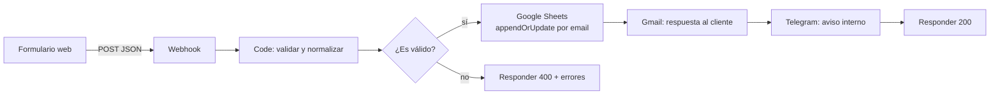

# Captura de leads con n8n — SOMOSBITS_

Workflow de **n8n** que recibe las solicitudes del formulario de contacto de la landing de SOMOSBITS_, las valida, las guarda en Google Sheets sin duplicados, le responde al cliente por correo y avisa al equipo por Telegram.



## Problema que resuelve

Antes, los mensajes del formulario llegaban a un correo y había que copiarlos a mano a una hoja de cálculo. Algunos se quedaban sin respuesta, había registros repetidos cuando un cliente escribía dos veces y llegaba spam de bots.

## Qué hace el workflow

| Paso | Nodo | Detalle |
|---|---|---|
| 1 | **Webhook** (`POST /webhook/leads-somosbits`) | Recibe el JSON del formulario. Responde al final con un nodo *Respond to Webhook*, así el formulario sabe si todo salió bien. |
| 2 | **Code** (JavaScript) | Limpia HTML y espacios, pasa el email a minúsculas, normaliza celulares colombianos a `+57XXXXXXXXXX`, limita longitudes, valida campos y detecta bots con un campo *honeypot*. |
| 3 | **IF** | Separa leads válidos de inválidos. |
| 4 | **Google Sheets** | Operación `appendOrUpdate` con `email` como columna de coincidencia: si la persona vuelve a escribir, se actualiza su fila en vez de duplicarla. |
| 5 | **Gmail** | Envía al cliente una confirmación automática personalizada. |
| 6 | **Telegram** | Avisa al equipo con el resumen del lead para responder rápido. |
| 7 | **Respond to Webhook** | `200 {"ok":true}` o `400 {"ok":false,"errores":[...]}`. |

Gmail y Telegram tienen *On Error → Continue*: si falla una notificación, el lead igual queda guardado y el formulario recibe su respuesta.

## Estructura del repositorio

```
workflow/captura-leads.json   ← workflow listo para importar en n8n
workflow/plantilla.json       ← plantilla sin el código del nodo Code
src/validarLead.js            ← lógica del nodo Code (probada con Node)
test/validarLead.test.js      ← pruebas unitarias
scripts/build.js              ← inyecta src/ en la plantilla y genera el workflow
examples/formulario.html      ← formulario de ejemplo que llama al webhook
examples/lead-valido.json     ← payload de prueba
```

La lógica del nodo Code vive en `src/` para poder versionarla y probarla fuera de n8n; `npm run build` la inserta en el JSON del workflow.

## Cómo usarlo

1. `npm test` → corre las pruebas de validación (Node 18+).
2. `npm run build` → regenera `workflow/captura-leads.json`.
3. En n8n: **Workflows → Import from File** → `workflow/captura-leads.json`.
4. Crea una hoja de Google con una pestaña `Leads` y las columnas `fecha, nombre, email, telefono, servicio, mensaje, origen, estado`.
5. Configura credenciales de Google Sheets, Gmail y Telegram, y reemplaza `REEMPLAZAR_ID_DE_LA_HOJA` y `REEMPLAZAR_CHAT_ID`.
6. Activa el workflow y prueba:

```bash
curl -X POST https://TU-INSTANCIA-N8N/webhook-test/leads-somosbits \
  -H "Content-Type: application/json" \
  -d @examples/lead-valido.json
```

En producción conviene cambiar `allowedOrigins` del Webhook de `*` al dominio de la landing.

## Tecnologías

n8n · JavaScript (Node.js) · Webhooks / REST · Google Sheets API · Gmail API · Telegram Bot API · HTML

---
Daniel — SOMOSBITS_
